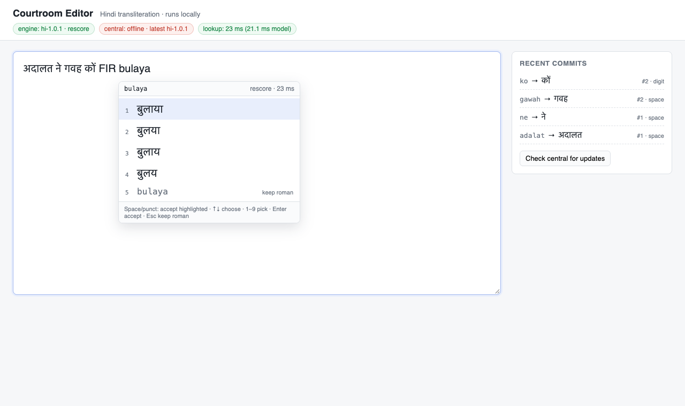

# IndicXlit Courtroom Runtime

**Shippable prototype** for the courtroom transliteration assignment: live Hindi
suggestions for typists, with the model on the typist's machine and a central
registry that only distributes versioned packages. Decision history:
[IterativeIdeation.md](IterativeIdeation.md).

| Doc | What it is |
|---|---|
| [docs/DESIGN.md](docs/DESIGN.md) | Decisions: where it runs, how it is distributed, how we prove it |
| [docs/HLD.md](docs/HLD.md) · [docs/LLD.md](docs/LLD.md) | Components and module contracts |
| [docs/REPORT.md](docs/REPORT.md) | **Final report**: workload, options, what was built vs designed, benchmarks, stress tests, cost, future work |
| [results/results_summary.md](results/results_summary.md) | Every measured number, by results file |
| [docs/OPEN_QUESTIONS.md](docs/OPEN_QUESTIONS.md) | Open for interpretation + next steps |

```
 Browser editor ──keystroke──▶ Local Xlit Service (127.0.0.1:8765) ──poll / download──▶ Central Model Registry (:8700)
     (C1)                         (C2: engine + cache + sync)        off hot path          (C3: manifests + artifacts)
```

---

## What you get

1. **Working end-to-end path** — editor UI → local suggest API → staged engine upgrades → central package registry.
2. **Design scenarios covered by tests** — bootstrap → rescore stage/promote; new version with local dedupe + prune; offline boot; Range resume + integrity reject; API validation.
3. **Assignment harnesses** — quality gate (exact-match top-k), HTTP typing/load harness (3 latency layers), cost model with explicit assumptions.
4. **Privacy-safe logs by default** — roman text / chosen candidates are not written at INFO unless you pass `--log-content`.

---

## Layout

```
.
├── xlit/
│   ├── common/          # manifest schema, JSON logging, HTTP helper
│   ├── central/         # registry, publisher CLI, HTTP server
│   └── local/           # engine, manager, package store, sync agent, UI
├── tests/               # unittest (fake engine; no model download)
├── benchmarks/
│   ├── latency_baseline.py   # stock engine compute sweep
│   ├── latency_http.py       # HTTP typing / burst harness
│   ├── quality_dakshina.py   # exact-match quality gate
│   ├── cost_model.py         # $/mo and $/1k users
│   ├── wan_proxy.py          # courtroom link emulator in front of central
│   └── fleet_stress.py       # N real local services + N typists, keystroke by keystroke
├── data/                # checked-in Hindi sample, courtroom NE set, stress sentences
├── docs/                # design + report + open questions
├── results/             # committed baseline numbers + harness outputs
├── Makefile
├── requirements-runtime.txt   # Flask/requests — enough for tests + cost + HTTP self-test
└── requirements-ml.txt        # IndicXlit + torch freeze; `make setup` installs it with --no-deps
```

---

## Quick path (no model) — verify the runtime logic

Requires **Python 3.10**.

```bash
make setup-runtime          # .venv + Flask/requests only
make demo-check             # unit tests + cost model + HTTP self-test
```

Expected: all tests pass; `results/cost_model.json` and `results/latency_http_selftest.json` written.

---

## Full demo (real IndicXlit)

### 1. Setup once

```bash
make setup                  # runtime deps + requirements-ml.txt (IndicXlit + torch)
make warm-model             # library downloads stock weights + Hindi rescore dict
```

`make setup` pins `pip<24.1` and installs the freeze with `--no-deps`. Two pins force that:

- `fairseq 0.12` → `omegaconf==2.0.6` declares `PyYAML>=5.1.*` (pip ≥24.1 refuses it).
- `torch==2.5.1` next to `torchaudio==2.11.1` is rejected by the resolver; `--no-deps` installs the combination this environment runs.

### 2. Publish + run (two terminals)

```bash
make publish                # → var/registry/hi/hi-1.0.0  (~138 MB base + ~358 MB rescore)
make central                # terminal 1  → :8700
make local                  # terminal 2  → :8765
```

Open **http://127.0.0.1:8765/**. Fresh machine: downloads **base**, serves suggestions, then downloads **rescore** in the background and swaps it in at the next word boundary. Later starts boot from `var/local_store` before contacting central (offline-capable).

A 45-second walkthrough of that editor, with a caption on each shot for what is happening and what comes next, is in [docs/demo/courtroom-editor-demo.mp4](docs/demo/courtroom-editor-demo.mp4). It was recorded with the registry unreachable, so the suggestions come from the local package. Still frames are in [docs/demo/frames](docs/demo/frames).

### 3. Editor keys

| Key | Action |
|---|---|
| latin letters | refine prefix; dropdown updates every keystroke |
| Space / punctuation | accept highlighted (#1 default) and insert the key |
| ↑ / ↓ · 1–9 · click | pick another candidate |
| Esc | keep roman for this word (e.g. `FIR`) |

Status bar: active version/tier, staged upgrade, central state, download progress, last lookup latency.



---

## Demo scenarios (design coverage)

**Progressive upgrade** — empty store (`rm -rf var/local_store`), start local, watch logs for `package_download_*` → `engine_promoted reason=first_engine` → `engine_staged` (rescore) → `engine_promoted reason=commit|word_start|idle`.

**New version rollout**
```bash
python -m xlit.central.publish --version hi-1.0.1
curl -X POST localhost:8765/v1/sync
```
Unchanged files hard-link locally (`file_reused_locally`); new engine stages, promotes at a word boundary; old version pruned.

**Courtroom link drop** — stop central. Status → `central: offline`; suggestions keep working. Restart central → `central_online`.

**Interrupted download** — `python -m xlit.central.server --chaos-fail-rate 0.5` on an empty store. Downloads resume (`file_downloaded resumed_from=…`).

**Rollback** — `echo hi-1.0.0 > var/registry/hi/LATEST` (versions are immutable; clients follow `LATEST`).

---

## Benchmarks & cost

```bash
make bench-cost             # no model needed
make bench-http-selftest    # no model needed (fake engine over real HTTP)
make bench-latency          # needs ML setup — stock compute p50/p95/p99
make bench-quality          # needs ML setup — stock top-1 / top-k on data/dakshina_hi_sample.tsv
```

Stress tests (need ML setup; central and the court-link emulator running):

```bash
make central                # terminal 1: registry on :8700
make wan-proxy              # terminal 2: court link on :8701 (60 ms RTT, 100 Mbps shared)
make bench-fleet            # 16 fresh local services over the link, then 16 typists
```

The full list of stress runs, their commands, and their results is in
[results/results_summary.md](results/results_summary.md#fleet-stress).

Against a live local service (after `make local` is warm):

```bash
python -m benchmarks.latency_http --url http://127.0.0.1:8765 --scenario all
python -m benchmarks.quality_dakshina --arms stock,base,rescore \
  --package-dir var/local_store/packages/hi/hi-1.0.0
```

Quality gate: packaged `base` must emit the **same candidates** as stock on the same inputs (packaging regression). The recorded run is `results/quality_dakshina.json`: base lists match stock (sample top-1 78.77%, top-4 94.07%), and rescore lifts sample top-1 to 86.91%. The published Dakshina Hindi top-1 of 60.56 needs the official test split; this sample is the packaging gate.

Cost model (assumptions are estimates to verify): with ~200 court mirrors, central ≈ **$40/mo** (~$8 / 1k users) vs ~$240/mo if every machine pulls direct, vs ~$380/mo for a single always-on GPU instance that still fails the latency/blackout story. Details: `make bench-cost` and [docs/REPORT.md](docs/REPORT.md).

---

## Tests

```bash
make test                   # 29 tests, a few seconds, no model
```

---

## API sketch

Local (`127.0.0.1:8765`): `GET /v1/suggest?q=mera&k=4&word_start=0` · `POST /v1/events` · `GET /v1/status` · `POST /v1/sync` · `GET /healthz`

Central (`:8700`): `GET /v1/models/<lang>/latest` (ETag/304) · `GET /v1/models/<lang>/<version>/files/<path>` (Range) · `POST /v1/heartbeat` · `GET /healthz`

Full contracts: [docs/LLD.md](docs/LLD.md).

Useful local flags: `--rescore {auto,on,off}`, `--poll-interval`, `--beam-width`, `--topk`, `--idle-promote`, `--log-content` (opt-in content logging).

---

## Measured on a MacBook (localhost)

| Metric | Value |
|---|---|
| Time to first suggestion (fresh, incl. 138 MB base pull) | ~4.7 s |
| Restart from local cache | ≈ base engine load (~3–4 s) |
| Keystroke lookup (browser RTT + compute) | 15–30 ms (model 13–27 ms) |
| Cached prefix | ~0.1 ms server side |
| Rescore load from local disk (Hindi dict) | ~2.3 s |
| RSS | ~0.5 GB base / ~1.7 GB rescore |

These are **fast-hardware** numbers. A 3–5× slower court PC is why the design has a hardware gate and a Tier B fallback ([OPEN_QUESTIONS.md](docs/OPEN_QUESTIONS.md)).

---

## Intentionally not in this prototype

Signed manifests, cohort rollouts, court LAN mirror implementation, multi-worker Tier B, TLS/authN for non-localhost. Designed and sequenced in DESIGN / OPEN_QUESTIONS; not required to demonstrate the runtime choice.
