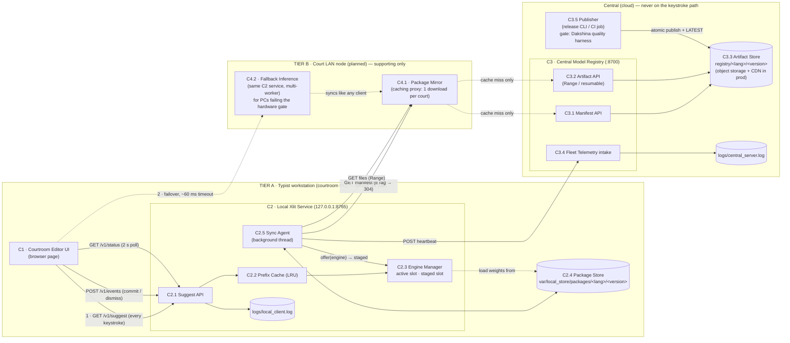
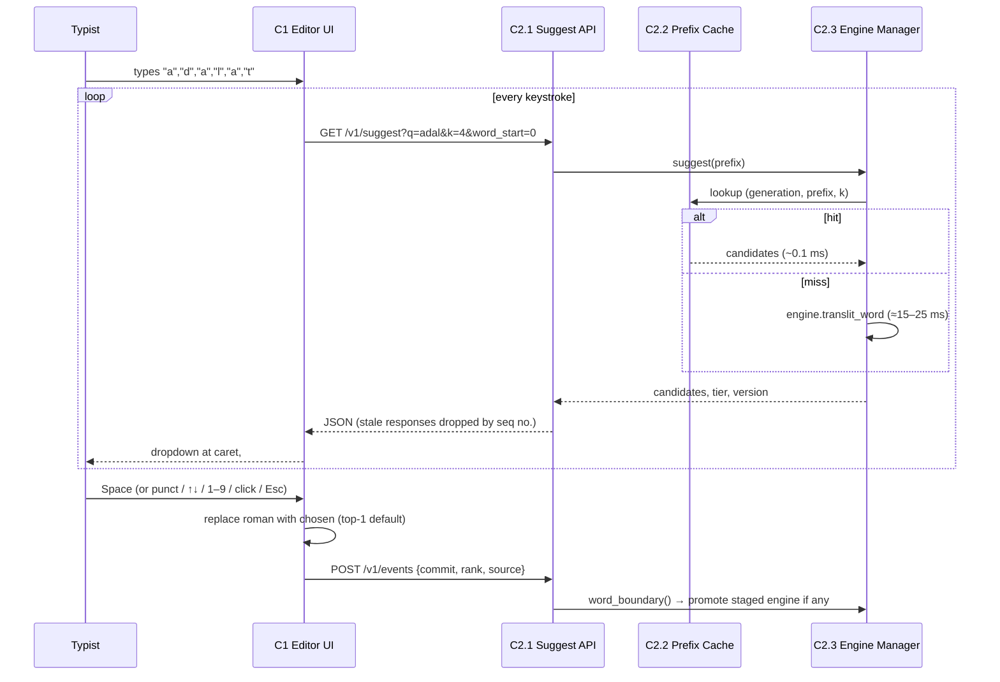
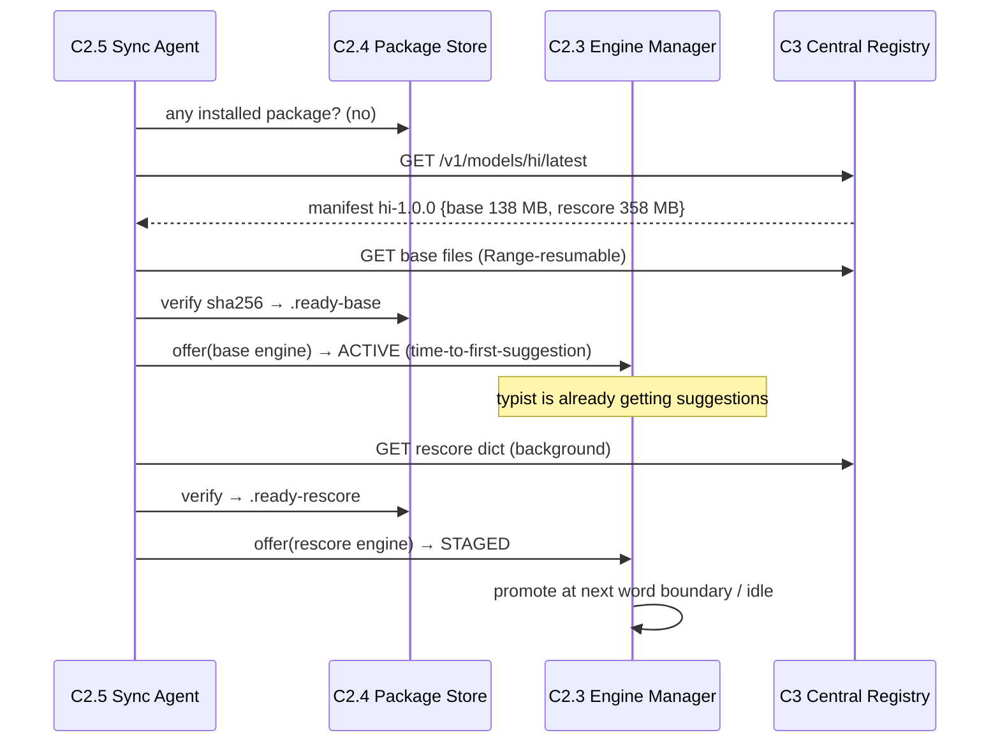
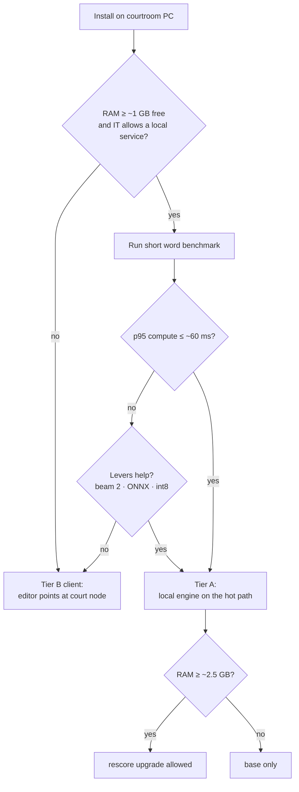

# HLD — IndicXlit Courtroom Transliteration Runtime

**One line:** run IndicXlit *on the typist's machine* for every keystroke (**Tier A**); keep a **court LAN node** as package mirror and weak-PC fallback (**Tier B**); use the central service only to **distribute versioned model packages** — base weights first, rescore dictionary as a background upgrade.

Related: [final design decisions](DESIGN.md) · [LLD](LLD.md) · [decision log](../IterativeIdeation.md) · [README](../README.md)

Status legend: **[built]** works today · **[planned]** designed, not yet implemented.

---

## 1. Problem and constraints

| Constraint | What it forces |
|---|---|
| p95 < 100 ms **per lookup, end-to-end** | Keystroke path must not cross a WAN. Courtroom RTT alone (50–150 ms+, flaky) can exceed the budget even with a fast model. |
| Flaky / constrained courtroom links | Suggestions must keep working with the link down. Downloads must resume and verify. |
| ~5,000 DAU, ~500 concurrent at peak | Not one number: per-machine p95, central poll load (~8 req/s of 304s), and release-day egress are three separate budgets. |
| ~$500/month ceiling | No always-on GPU fleet. Central cost should be ~storage + egress, independent of keystrokes. |
| No quality regression | Same IndicXlit weights and decoding as stock; rescore (dictionary) available as an upgrade, not dropped. |
| **Unknown / mixed courtroom hardware** | The hot path must be gated on a measured per-machine check, with a defined fallback for PCs that fail it. |

Measured inputs (stock Hindi `XlitEngine`, dev laptop, see `results/`):
warm compute p95 ≈ 15–50 ms (beam 4), base engine load ≈ 2.6–4.2 s, base package 138 MB, Hindi rescore dict 358 MB, RSS ≈ 0.5 GB base / ≈ 1.7 GB with rescore.

> These are **fast-hardware** numbers. A 3–5× slower court PC lands near the bar, which is why §3.5's hardware gate exists.

---

## 2. Components: names, placement, responsibilities



| ID | Component | Runs where | Responsibility | On keystroke path? |
|---|---|---|---|---|
| C1 | **Courtroom Editor UI** [built] | Typist's browser | Owns the roman prefix. Fires a lookup per keystroke, renders the caret-anchored dropdown, commits on Space/punct/pick, keeps roman on Esc. Failover chain [planned]. | **Yes** (origin) |
| C2 | **Local Xlit Service** [built] | Typist PC, bound to localhost | Serves suggestions from a warm local engine. Never waits on the network. | **Yes** |
| C2.1 | Suggest API | in C2 | Validates input, routes to cache/engine, logs every lookup. | Yes |
| C2.2 | Prefix Cache | in C2 (RAM) | LRU of `(engine generation, prefix, k)`; backspace / retyped prefixes return in ~0.1 ms. | Yes |
| C2.3 | Engine Manager | in C2 (RAM) | Holds **active** and **staged** engines. Promotes staged only at a word boundary (next word start, commit, or idle) so the list never reshuffles mid-word. | Yes |
| C2.4 | Package Store | Typist PC disk | Versioned, sha256-verified packages, ready-markers, local dedupe across versions, pruning. | No |
| C2.5 | Sync Agent | in C2 (thread) | Boot from disk → poll registry → download missing packages → load & stage engines → prune → heartbeat. Backoff when offline. | No |
| C3 | **Central Model Registry** [built] | Cloud (single small VM / container) | Source of truth for "latest model per language" and the bytes. | **No** |
| C3.1 | Manifest API | in C3 | `GET /v1/models/<lang>/latest` with ETag → 304 when unchanged. | No |
| C3.2 | Artifact API | in C3 | Immutable files with Range support (resumable on flaky links), only paths listed in the manifest. | No |
| C3.3 | Artifact Store | Cloud storage | `registry/<lang>/<version>/…` + `LATEST` pointer. Prod: object storage bucket behind a CDN. | No |
| C3.4 | Fleet Telemetry | in C3 | Heartbeats: active version/tier, p95 compute, cache hit rate → rollout visibility and rollback triggers. | No |
| C3.5 | Publisher | Release pipeline | Packages weights + dict, computes sha256, publishes atomically, moves `LATEST`. **Gate: Dakshina quality harness must pass.** | No |
| **C4** | **Court LAN node** [planned] | Court server room | Two roles, both supporting. Never the sole path for a courtroom. | Only for C4.2 clients |
| C4.1 | Package Mirror | in C4 | Caching proxy for C3 — each release crosses the court uplink **once per court**, not once per machine. Also enables staggered rollout windows. | No |
| C4.2 | Fallback Inference | in C4 | The same C2 service, multi-worker, for PCs that fail the hardware gate or where IT forbids a local service. Needs TLS + authN (no longer localhost-only). | Yes, for those clients |

**Why C4 is supporting and not primary:** a single box per court is one power cut, one LAN switch, or one maintenance window away from taking the whole courtroom down. Tier A has no such shared failure.

---

## 3. Key interactions

### 3.1 Keystroke → suggestion (hot path, all local)



Latency budget (measured): browser↔localhost RTT ≈ 1–3 ms, model ≈ 13–27 ms warm → **15–30 ms end-to-end**, ~70 ms headroom under 100 ms. No WAN anywhere in this path.

### 3.2 First boot on a fresh machine → progressive upgrade



Rules: never block boot on rescore; a file on disk is not "ready" until verified *and* the engine loaded + warmed.

### 3.3 Model rollout (new version)

1. Publisher (C3.5) publishes `hi-1.0.1` into a staging dir, writes the manifest last, renames atomically, then swaps `LATEST`.
2. Each Sync Agent's next poll gets a 200 instead of a 304, diffs files by sha256, **hard-links unchanged files locally**, and downloads only changed ones.
3. New engine is loaded and **staged**, promoted at a word boundary. A client on rescore waits for the new rescore package rather than stepping down to base.
4. Old versions are pruned once nothing references them. Rollback = point `LATEST` back (versions are immutable).

### 3.4 Courtroom link drops

Sync Agent marks central `offline` (logged once), backs off exponentially with jitter (cap 5 min; 5 s while nothing is installed). The Suggest API keeps serving the installed engine. Downloads resume from the `.part` offset on reconnect. A restart while offline boots straight from the Package Store.

### 3.5 Placement decision and failover [planned]

**At install time**, a machine is assigned a tier by a measured gate — not by assumption:



Thresholds above are the **starting proposal**; the real values come from benchmarking actual court hardware (see [DESIGN §5.2](DESIGN.md#52-latency-and-load)).

**At runtime**, the editor walks a fixed chain:

```
1. localhost (Tier A)            →  normal case, 15–30 ms
2. court node (Tier B)           →  ~60 ms timeout, LAN only
3. no suggestions                →  typing is NOT blocked
```

Step 3 is a designed state, not a crash: the dropdown says why, the roman text stays in the document, and the typist converts later. **No cloud inference in this chain** — it cannot meet 100 ms over court links and is unavailable during exactly the outages that matter.

### 3.6 Failure matrix

| Failure | Tier A machine | Tier B client | Whole court |
|---|---|---|---|
| Central registry / internet down | Unaffected (updates pause) | Unaffected | Unaffected |
| Court node down / maintenance | Unaffected | **Loses suggestions** (chain step 3) | Partially degraded |
| Court LAN / switch failure | Unaffected | **Loses suggestions** | Partially degraded |
| Power cut | Down (unless UPS/laptop) | Down | Down — out of scope for software |
| Bad model release | Rollback via `LATEST`; versions immutable | Same | Same |

This is the core argument for Tier A as default: the only failures that take it out also take out the PC itself.

---

## 4. How the design meets each requirement

| Requirement | Mechanism | Evidence today |
|---|---|---|
| p95 < 100 ms | Local engine + prefix cache, no WAN on hot path | 15–30 ms per keystroke measured; cached 0.06 ms. **Still to prove on the weakest supported PC.** |
| Flaky links | Offline-first boot, resumable + verified downloads, backoff | Central killed → suggestions continue; tests cover resume + corruption |
| Scale (500 concurrent) | Compute scales with the typists' own CPUs; central handles only polls + downloads | 500 clients × 1 poll/min ≈ 8 req/s of 304s |
| Cost | Central ≈ 1 small VM + storage/CDN egress; C4.1 mirror cuts egress per court | ~$240/mo direct vs ~$40/mo with mirrors (estimates, [DESIGN §5.3](DESIGN.md#53-cost-model)) |
| Quality | Identical stock weights/decoding; rescore delivered as an upgrade | `results/quality_dakshina.json`: packaged base ≡ stock (sample top-1 78.77%); rescore top-1 86.91%. Official Dakshina split still open. |
| Mixed hardware | Hardware gate assigns Tier A or Tier B per machine | [planned] |
| Observability | JSON logs on both sides; heartbeats with version/tier/p95 | `logs/local_client.log`, `logs/central_server.log` |

---

## 5. Alternatives considered (summary)

| Option | Why not primary |
|---|---|
| Central always-on GPU API | RTT over courtroom links breaks p95; dark link = same outage as today; ~$380/mo per instance before redundancy, scaling with courts. |
| Central CPU API (shared) | Same RTT and outage problem. Compute was never the bottleneck. |
| Per-client on-demand server spin-up | Seconds-to-minute cold start, memory per session, cost. |
| Serverless | Cold start is a first-class latency failure for a per-keystroke workload. |
| **Court node as the primary path** | One box per court = single point of failure for power, LAN and maintenance; needs TLS/authN/multi-worker and on-site hands. Kept as mirror + fallback (C4). |
| **Model download on user login** | A login at hearing time cannot absorb 138 MB. Moved to machine provisioning + background update. |
| Rescore required at boot | Blocks the first suggestion behind a 358 MB download and ~1.7 GB RSS; fragile on slow links. |

Full reasoning, including what each alternative would have cost us: [DESIGN §6](DESIGN.md#6-alternatives-considered-and-rejected).

---

## 6. Risks and what breaks at 10×

| Risk | Mitigation / next step |
|---|---|
| **Slow court PCs** (our numbers are dev-laptop numbers) | Hardware gate (§3.5); reserve levers: beam 2, ONNX, int8 — each re-gated by the Dakshina harness. |
| Low-RAM courtroom PCs (rescore ≈ +1.2 GB) | `--rescore auto` already gates on RAM; trimmed frequency dictionary. |
| 50k users × release egress | C4.1 mirror per court (~25× reduction); CDN; sha256 dedupe already avoids re-downloading unchanged files. |
| Bad model release | Quality gate in Publisher; cohort rollout driven by heartbeats; automatic rollback thresholds; instant rollback via `LATEST`. |
| Tampered artifacts | sha256 enforced today; next: ed25519-signed manifests with the public key pinned in C2. |
| Courtroom text in logs | Redact `q` / `top1` / `chosen` at INFO before any pilot; keep lengths, ranks, latencies. |
| Tier B becomes widely needed | Then it needs multi-worker inference, a second node, and a UPS — budget it as capex per court, decided by the gate pass rate. |
