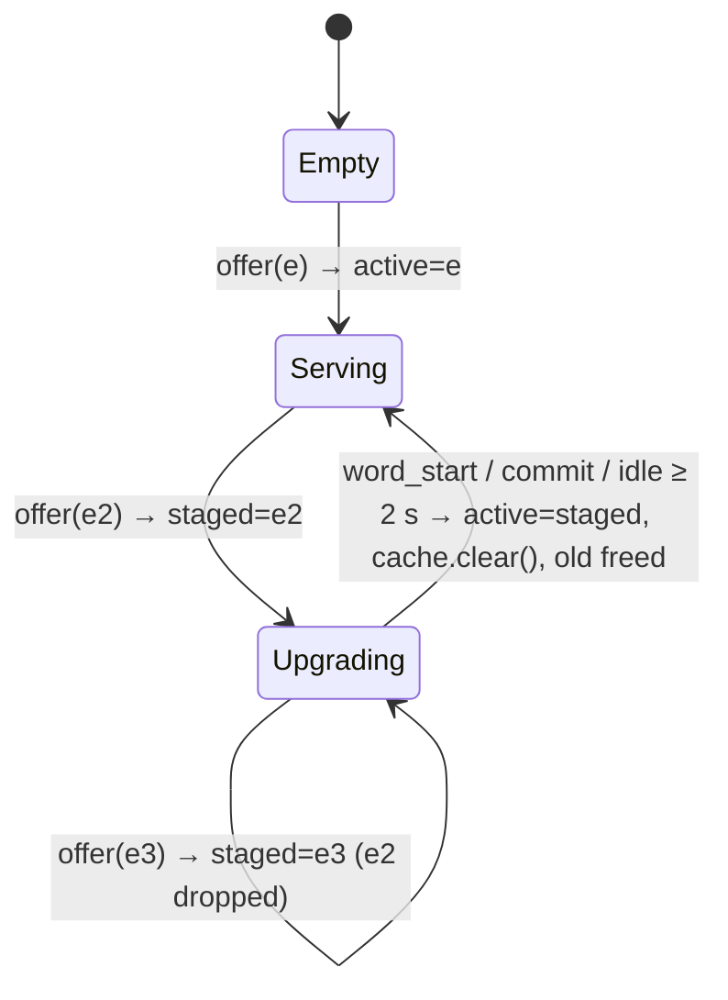

# LLD — IndicXlit Courtroom Transliteration Runtime

Companion to [HLD](HLD.md). Describes modules, contracts, state machines, concurrency and failure handling as implemented in `xlit/`.

---

## 1. Module map

```
xlit/
├── common/
│   ├── manifest.py        # Manifest / Package / FileEntry schema, validation, sha256 helpers
│   ├── logging_setup.py   # JSON-lines file logs + console; log_event(logger, level, event, **fields)
│   └── http.py            # Threaded WSGI server without reverse-DNS stall at bind
├── central/               # C3 Central Model Registry
│   ├── registry.py        # ModelRegistry: on-disk layout, atomic publish, LATEST pointer
│   ├── publish.py         # C3.5 Publisher CLI: library model dir -> registry version
│   └── server.py          # Flask app: manifest, artifacts (Range), heartbeat, chaos knobs
└── local/                 # C2 Local Xlit Service
    ├── config.py          # LocalConfig (frozen dataclass), RAM gate for rescore
    ├── central_client.py  # CentralClient: ETag polling, resumable+verified downloads
    ├── package_store.py   # C2.4 PackageStore: versions, ready markers, dedupe, prune
    ├── engine.py          # PackagedXlitEngine (subclass of library base), LoadedEngine
    ├── engine_manager.py  # C2.3 EngineManager + LRU (C2.2) + plan_next_load policy
    ├── sync_agent.py      # C2.5 SyncAgent thread: reconcile loop
    ├── server.py          # C2.1 Flask app + CLI entrypoint
    └── static/            # C1 Editor UI (index.html, app.js, style.css)
tests/                     # unittest: manifest, engine manager/policy, end-to-end over HTTP
```

Dependency direction: `local → common`, `central → common`. `local` never imports `central` (only tests do). Only `local/engine.py` imports torch/fairseq, lazily, so the rest is testable without the model.

---

## 2. Data contracts

### 2.1 Manifest (schema 1)

```json
{
  "schema": 1,
  "lang": "hi",
  "version": "hi-1.0.0",
  "created_at": "2026-11-02T04:22:51Z",
  "engine": {"family": "IndicXlit", "library_assets": "v1.0", "beam_width": 4},
  "packages": {
    "base":    {"size": 138302865, "files": [{"path": "model/transformer/indicxlit.pt", "size": 138135425, "sha256": "…"}, "…"]},
    "rescore": {"size": 358118856, "files": [{"path": "model/word_prob_dicts/hi_word_prob_dict.json", "size": 358118856, "sha256": "…"}]}
  }
}
```

Validation (`xlit/common/manifest.py`): `lang` `^[a-z]{2,3}$`; `version` `^[A-Za-z0-9][A-Za-z0-9._-]{0,63}$`; artifact paths are relative POSIX, with no `..`, `.`, empty segments, or backslashes; sha256 is 64 hex chars; `base` is mandatory. Versions are **immutable**: republishing the same id is rejected.

### 2.2 Version directory layout (identical on central and local)

```
<version>/
├── manifest.json
├── lang_list.txt                         # engine expects it at models_path/../lang_list.txt
└── model/                                # == engine models_path
    ├── corpus-bin/dict.*.txt             # fairseq vocab (all langs, ~180 KB)
    ├── transformer/indicxlit.pt          # weights (138 MB)
    └── word_prob_dicts/hi_word_prob_dict.json   # rescore package only (358 MB)
```

Central root: `var/registry/<lang>/{LATEST, <version>/…}`.
Local root: `var/local_store/{client_id, packages/<lang>/<version>/{…, .ready-base, .ready-rescore}}`.

### 2.3 Central HTTP API (C3, default `:8700`)

| Method & path | Response | Notes |
|---|---|---|
| `GET /healthz` | `{"status":"ok"}` | |
| `GET /v1/models/<lang>/latest` | manifest JSON, `ETag: "<lang>:<version>"` | `If-None-Match` → **304** (cheap polling) |
| `GET /v1/models/<lang>` | `{latest, versions[]}` | ops / debugging |
| `GET /v1/models/<lang>/<version>/manifest` | manifest JSON | `Cache-Control: immutable` |
| `GET /v1/models/<lang>/<version>/files/<path>` | bytes; **206** on `Range` | only manifest-listed paths; `X-Content-SHA256` |
| `POST /v1/heartbeat` | `{ok, latest_version}` | allow-listed fields only, body ≤ 4 KB |

Errors: 400 on invalid lang/version/path, 404 on unknown, 503 when `--chaos-fail-rate` is injecting failures.

### 2.4 Local HTTP API (C2, `127.0.0.1:8765`)

| Method & path | Request | Response |
|---|---|---|
| `GET /v1/suggest` | `q` = 1–48 latin letters (lower-cased), `k` ≤ beam, `word_start=0/1` | `{q, candidates[], version, tier, cached, compute_ms, server_ms, request_id}`; **503** `model_not_ready` before first package |
| `POST /v1/events` | `{type: commit/dismiss/error, source, roman, chosen, rank, shown, rtt_ms, session}` | `{ok, promoted}`; `commit` is a word boundary |
| `GET /v1/status` | – | `{engine:{active, staged, cache, p95_compute_ms, promotions}, sync:{central_state, download, loading, …}, config}` |
| `POST /v1/sync` | – | wake the Sync Agent now |
| `GET /`, `/static/*` | – | Editor UI |
| `GET /healthz` | – | 200 when an engine is active, else 503 `warming` |

---

## 3. Core classes

### 3.1 `PackagedXlitEngine` / `LoadedEngine` (`local/engine.py`)
* Subclasses the library's `BaseEngineTransformer` and passes `models_path` from the Package Store instead of site-packages. The library's own GitHub download logic is bypassed and inference code is unchanged, so quality is identical to stock.
* `load_engine(LoadRequest)` builds the engine, runs one warm-up `translit_word("namaste")`, and returns a `LoadedEngine` with a monotonically increasing `generation` (used in cache keys).
* `LoadedEngine.suggest` holds a per-engine lock: the fairseq generator is not documented as thread-safe, and a single typist means contention is negligible.

### 3.2 `EngineManager` (`local/engine_manager.py`)



* `suggest(prefix, k, word_start)`: under the manager lock it promotes when needed (`word_start` or idle), reads `active`, then releases the lock **before** inference. Cache key `(generation, prefix, k)`.
* In-flight lookups keep a reference to the old engine, so a swap never breaks them; memory is reclaimed after they finish (`gc.collect()`).
* `wants(version, tier)` stops the Sync Agent from reloading what is already active or staged.

### 3.3 `plan_next_load` (pure policy)

| Current (staged or active) | Target state | Next load |
|---|---|---|
| none | base ready | `(target, base)`, even if rescore is ready (fast first suggestion) |
| `(target, base)` | rescore ready & allowed | `(target, rescore)` |
| `(old, base)` | – | `(target, rescore)` if ready, else `(target, base)` |
| `(old, rescore)` | target ships rescore, allowed | wait until `(target, rescore)` is ready (**no quality downgrade**) |
| `(old, rescore)` | target has no rescore / rescore disabled | `(target, base)` |

Unit-tested exhaustively in `tests/test_engine_manager.py`.

### 3.4 `SyncAgent.reconcile_once` (`local/sync_agent.py`)

```
boot:  installed = store.installed_manifests(lang); if any → load base of newest (offline-capable)
loop:
  try   manifest ← central.latest(If-None-Match)      # 304 → keep cached manifest
  except CentralUnavailable → state=offline, fall back to newest installed manifest
  if base not ready and online:      store.install(m, base)      # dedupe → download → verify → marker
  maybe_load(m)                                                  # plan_next_load → loader → manager.offer
  if rescore allowed and m.has_rescore:
      if not ready and online:       store.install(m, rescore)
      maybe_load(m)
  prune(keep = {target, active.version, staged.version})
  heartbeat (online only)
  sleep: poll_interval on success; ×2 backoff (cap 300 s) on failure; ≤ 5 s while nothing is active; ±20 % jitter
```

### 3.5 `CentralClient.download_file`
1. If `<dest>.part` exists, re-hash it and resume with `Range: bytes=<n>-`. If the server answers 200 instead of 206, restart from zero.
2. Stream in 1 MB chunks, updating sha256 and progress.
3. Size and sha256 must match the manifest, otherwise delete `.part` and raise `IntegrityError`.
4. `os.replace(.part → dest)`. A file at its final path is therefore always verified.

Timeouts: connect 2 s (fail fast when the court link is down), read 30 s.

### 3.6 `PackageStore`
* `is_ready` = ready-marker present **and** every file exists with the expected size (cheap at boot; no rehash of 500 MB).
* `install` reuses identical files (same path + sha256) from another installed version via hard link, otherwise downloads them.
* `prune(keep)` removes other version dirs.

### 3.7 `ModelRegistry.publish`
Stage into `.<version>.staging/` (hard links by default) → sha256 each file → write `manifest.json` last → `os.replace` into `<version>/` → `LATEST` via temp file + `os.replace`. Readers never see partial versions.

---

## 4. UI behaviour (C1, `static/app.js`)

| Input | Effect |
|---|---|
| latin letter | refine prefix; `GET /v1/suggest` (sequence-numbered; stale responses ignored); dropdown anchored at word start (mirror-div caret math) |
| Space / `. , ? ! ; : ( ) - ।` | accept highlighted (default #1) **and** insert the key; waits for the in-flight lookup if the typist outran it |
| Enter / Tab | accept highlighted, no extra char |
| ↑ / ↓ | move highlight (wraps; last row = keep roman) |
| 1–9 | accept that row |
| click | accept that row (mousedown, focus kept) |
| Esc | close list for this word; the following Space inserts a plain space |
| service down / 503 | dropdown shows the reason; Space inserts a space and roman text stays |

Every commit and dismiss is posted to `/v1/events`; the status bar polls `/v1/status` every 2 s (engine tier, staged/loading, central state, download progress, last lookup latency).

---

## 5. Concurrency model

| Thread | Owns | Shares via |
|---|---|---|
| HTTP worker threads (werkzeug threaded) | request handling | `EngineManager` (RLock for slot pointers; per-engine lock for inference), `LRUCache` (own lock) |
| `sync-agent` daemon | downloads, engine loads (blocking, 2–5 s), pruning | `EngineManager.offer`, own `_lock` for status fields |

Engine loads happen only on the sync thread, so the hot path never blocks on I/O or model loading. Promotion is O(1) pointer swap.

---

## 6. Logging and observability

Both processes write JSON lines (`xlit/common/logging_setup.py`), rotating at 10 MB × 5:

| File | Logger names | Key events |
|---|---|---|
| `logs/local_client.log` | `xlit.local.http`, `.ui`, `.sync_agent`, `.engine`, `.engine_manager`, `.package_store`, `.central_client` | `suggest` (q, top1, cached, compute_ms, total_ms, tier, version), `ui_commit` / `ui_dismiss` (rank, source, rtt_ms), `time_to_first_suggestion`, `package_download_*`, `file_downloaded` (resumed_from), `engine_load_*`, `engine_staged`, `engine_promoted` (reason), `central_offline` / `central_online`, `versions_pruned` |
| `logs/central_server.log` | `xlit.central.http`, `.fleet`, `.registry`, `.publish` | `http_request` (status, range, client_id, duration_ms), `client_heartbeat` (active version/tier, p95, cache hit rate), `version_published`, `latest_updated` |

Example queries: `jq -c 'select(.event=="suggest") | .total_ms' logs/local_client.log`, `jq -c 'select(.event=="engine_promoted")' logs/local_client.log`.

Privacy: INFO logs redact `q` / `top1` / `roman` / `chosen` by default and keep lengths, ranks and latencies. Pass `--log-content` on the local service to restore content fields for debugging.

---

## 7. Configuration (local)

| Flag | Default | Meaning |
|---|---|---|
| `--central-url` | `http://127.0.0.1:8700` | Central Model Registry |
| `--port` / `--host` | `8765` / `127.0.0.1` | keep localhost-only |
| `--beam-width` / `--topk` | 4 / 4 | `topk` is clamped to `≤ beam` |
| `--rescore` | `auto` | `auto` = upgrade if RAM ≥ `--rescore-min-ram-gb` (4) |
| `--poll-interval` | 60 s | central check cadence |
| `--idle-promote` | 2 s | idle time before a staged engine is swapped in mid-word |
| `--cache-size` | 4096 | prefix LRU entries |
| `--store-dir` / `--log-dir` | `var/local_store` / `logs` | |

Central: `--registry var/registry`, `--chaos-fail-rate`, `--chaos-delay-ms` (simulate a flaky uplink).

---

## 8. Error handling summary

| Failure | Behaviour |
|---|---|
| Central unreachable / 5xx | `CentralUnavailable` → offline state, backoff, keep serving |
| Download interrupted | `.part` kept → resumed next cycle |
| Corrupt bytes | `IntegrityError` → `.part` deleted → re-download next cycle |
| Engine load fails | logged with stack; current engine keeps serving; retried next cycle |
| No package and offline | `/v1/suggest` 503 `model_not_ready`; UI shows "model not installed yet"; retry every ≤ 5 s |
| Bad client input | 400 with reason; never reaches the engine |

---

## 9. Testing

`python -m unittest discover -s tests -t .` (29 tests, a few seconds, no model needed):
* manifest validation (path traversal, schema, sha)
* Engine Manager promotion rules, cache invalidation, `plan_next_load` matrix
* end-to-end over real HTTP: bootstrap → rescore staged → promote; new version with local dedupe + prune; offline boot from cache; Range resume and corruption rejection; local API validation; relative registry paths

Manual / integration: see README "Demo scenarios". These were run against the real IndicXlit weights.

---

## 10. Prototype vs production

| Prototype | Production |
|---|---|
| werkzeug threaded server | central: gunicorn behind a CDN, artifacts in object storage; local: same process packaged as an OS service / tray app |
| sha256 integrity | + signed manifests (ed25519), pinned key in the client |
| `LATEST` per language | cohort rollout (`LATEST` per channel / % of client_ids), driven by heartbeat health |
| INFO logs already redact roman / chosen text (`--log-content` to opt in) | retention policy for even redacted logs; metrics export instead of grepping logs |
| Hindi only | one package per language; manifests per `lang` already supported |
